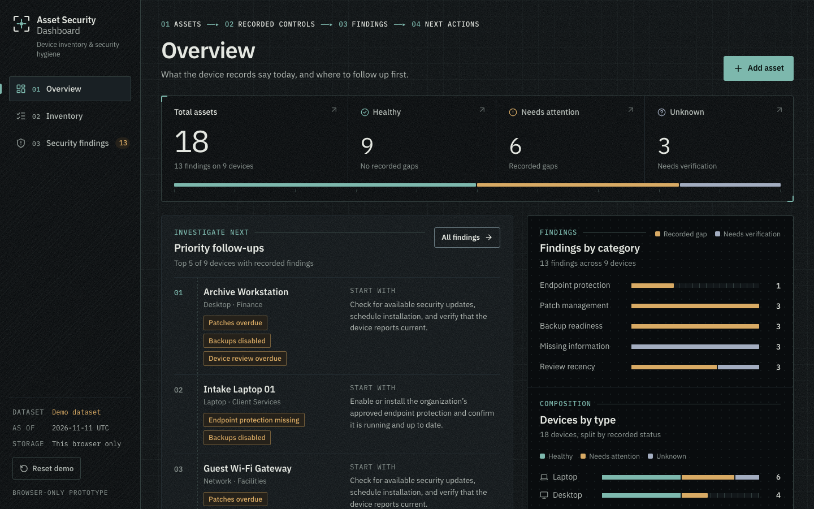
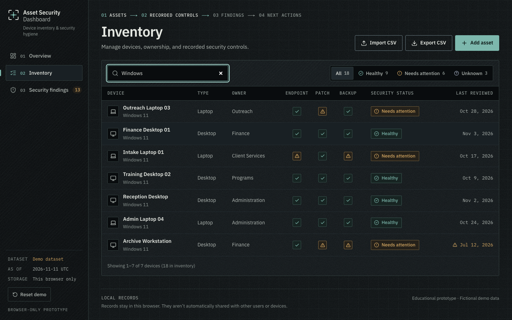

# Asset Security Dashboard

A browser-based asset inventory for small nonprofits. Track device ownership, endpoint protection, patching, and backups in one place. The dashboard applies explicit rules to flag recorded gaps and show what still needs verification.

Built as a Cyber Ready Clinic capstone. The app opens with 18 fictional nonprofit devices. The [current presentation](docs/presentation/Presenter_Guide_v2.md) is planned for about 4:35, under five minutes.

**[Live demo](https://ammaarrehman.github.io/asset-security-dashboard/)** · [Source code](https://github.com/ammaarrehman/asset-security-dashboard)

The public demo was verified in Chromium on 12 November 2026, including inventory editing, CSV workflows, refresh persistence, and mobile layouts. [Publication verification](docs/verification/publication/README.md)

## Capstone Presentation

Explore the Cyber Ready Clinic capstone through six slides and a timed presenter guide, including a 94-second recorded demonstration. The planned talk is about 4:35, under five minutes. The materials use fictional nonprofit data and explain the prototype's scope and limitations. Playback and delivery should be rehearsed on the presentation computer.

- [Download the current PowerPoint (v2)](docs/presentation/Asset_Security_Dashboard_CRC_Capstone_v2.pptx)
- [Read the current presenter guide](docs/presentation/Presenter_Guide_v2.md)
- [View the current slide preview](docs/presentation/Slides_Preview_v2.png)
- [Open the live application](https://ammaarrehman.github.io/asset-security-dashboard/)

The [presentation kit](docs/presentation/README.md) includes the recording, PDF fallback, and live-demo QR code. Archived originals remain available: [PowerPoint](docs/presentation/Asset_Security_Dashboard_CRC_Capstone.pptx), [guide](docs/presentation/Presenter_Guide.md), [preview](docs/presentation/Slides_Preview.png), and [outline](docs/capstone-outline.md). Their earlier timing is not the current under-five-minute plan. See [future improvement ideas](docs/future-improvements.md) for optional work beyond this presentation.

## Screenshots

Actual Chromium captures of the interface on this branch, using fictional demo devices and a fixed review date of 11 November 2026. See the [visual overhaul review](docs/verification/visual-overhaul/README.md) for results, coverage, and before-and-after sheets.

[Visual review contact sheet](docs/screenshots/visual-review.png) · [Download all screenshots](docs/screenshots/asset-security-dashboard-screenshots.zip)




<details>
<summary>Inventory, findings, and responsive layouts</summary>




| Mobile dashboard | Mobile inventory | Mobile asset editor |
| --- | --- | --- |
|  |  |  |

</details>

## Features

- Overview with total devices, three recorded security statuses, priority follow-ups in a documented fixed order, findings by category, device types, and a diagram of how recorded values lead to findings.
- Searchable, filterable inventory with add, edit, and confirmed delete.
- Device details with recorded controls, findings, and recommended actions.
- CSV import with validation and a confirmation preview. CSV export includes the full inventory and escapes formula-like cells.
- **Reset demo** restores the fictional dataset after confirmation.

## Run locally

Use Node.js 24.12 or later.

```sh
npm ci
npm run dev
```

Open the address printed by Vite, typically [http://localhost:5173/asset-security-dashboard/](http://localhost:5173/asset-security-dashboard/).

## Security rules

| Recorded condition | Finding | Recommended first step |
| --- | --- | --- |
| Endpoint protection is Missing | Endpoint protection missing | Enable approved protection and verify it is running and current. |
| Patch status is Overdue | Patches overdue | Schedule security updates and verify the result. |
| Backup status is Disabled | Backups disabled | Enable an approved backup process and test a restore. |
| Any of the three controls is Unknown | Security information missing | Verify the missing controls and update the record. |
| Review date is missing | Review date missing | Review the device and enter the date. |
| A saved review date is after today in UTC | Review date is in the future | Verify and correct the date. |
| Last review is more than 90 UTC calendar days old | Device review overdue | Recheck the device and update the review date. |

**Needs attention** means at least one recorded gap. **Unknown** means the record needs verification and the rules flagged no recorded gaps. **Healthy** means the record is complete for these checks and the rules flagged no gaps. It provides no assurance about the device itself. A device may contribute to several finding categories.

## CSV format

Start with [the sample CSV](public/sample-assets.csv). Use UTF-8 and keep all nine column names, in any order. The device name and device type are required. Blank protection, patch, and backup values become **Unknown**. Review dates use `YYYY-MM-DD` and must be today or earlier in UTC. The editor and importer apply the same field rules.

Imports append devices after confirmation and assign new IDs. Reimporting the same file adds new records. An invalid row rejects the full file. Files are limited to 3 MiB, and the inventory holds up to 1,000 devices. Exports quote every data field and prepend a protective apostrophe to formula-like text. Import removes one protective apostrophe from such fields so the values round-trip. If you edit an export in a spreadsheet, keep formula-like fields formatted as text. Some spreadsheet programs can remove the protection when saving a CSV again. [OWASP CSV injection guidance](https://owasp.org/www-community/attacks/CSV_Injection)

## Technology and limitations

React, strict TypeScript, Vite, Tailwind CSS, Lucide, Vitest, and browser LocalStorage.

Records stay in the current browser profile and site origin. Scripts on the same origin can access them. Records aren’t automatically shared with other users or devices. Clearing site data removes saved records. If storage is blocked, full, or unreadable, the app warns you and keeps session changes in memory so you can export them before leaving. CSV files are plain text.

This educational prototype evaluates manually entered records. It performs no device scanning, control verification, or compliance assessment. It has no authentication, server, or shared inventory. Use fictional or otherwise appropriate demonstration data.

## Testing and production build

```sh
npm run lint
npm run test
npm run build
npm run qa:visual
npm run preview
```

Vitest covers findings, status classification, CSV validation and export safety, inventory operations, and storage failure handling. The build checks TypeScript and writes the static app to `dist/`. Vite uses `/asset-security-dashboard/` as its base path for GitHub Pages.

On macOS, `npm run qa:visual` builds the production app and uses Playwright Chromium to check 1440×900, 1280×800, 768×1024, and 390×844 layouts, plus 320px and 600/621/640/660/680/700px reflow, keyboard interaction, inventory workflows, CSV import/export, and refresh persistence. It runs axe-core accessibility scans and captures real browser screenshots under ignored `test-results/browser-qa/`, or `ASSET_QA_OUTPUT` when supplied. All review images stay there. Playwright and axe-core are pinned development dependencies; the command downloads Chromium if it is missing. The app is loaded through local request interception at the configured base path, so no listening server or deployment is needed. A fresh isolated browser profile keeps existing browser records untouched.

Failures produce a nonzero exit status and `results.json` in the chosen output folder. Replacing committed captures, galleries, comparison images and the ZIP requires the explicit `--update-gallery` option (`npm run qa:update-gallery`) and happens only after browser assertions pass. Output under `docs/` is rejected without that option. The [earlier approved report](docs/verification/visual-overhaul/chromium/results.json) remains available. Inspect generated images after each run. Automated checks do not establish complete accessibility conformance or replace assistive-technology testing.

GitHub Actions runs a clean install, lint, tests, TypeScript checks, and the production build on every push to `main`, then deploys `dist/` to GitHub Pages. The workflow also supports manual dispatch and serializes deployments. [Deployment runs](https://github.com/ammaarrehman/asset-security-dashboard/actions/workflows/deploy-pages.yml)

To run the same browser suite against the public deployment without changing the screenshot gallery:

```sh
ASSET_QA_URL=https://ammaarrehman.github.io/asset-security-dashboard/ \
ASSET_QA_OUTPUT=/tmp/asset-security-live-qa \
node scripts/verify-browser.mjs
```

## License

[MIT](LICENSE), copyright 2026 Ammaar Rehman.
